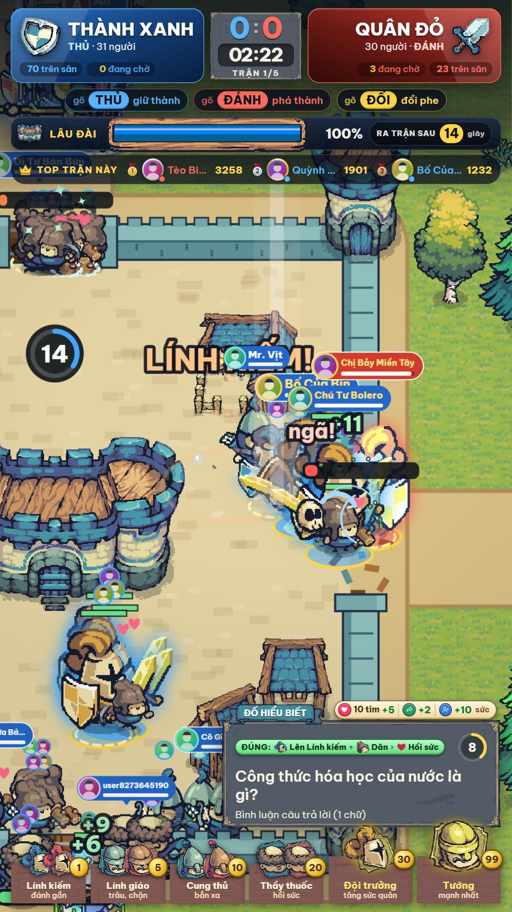
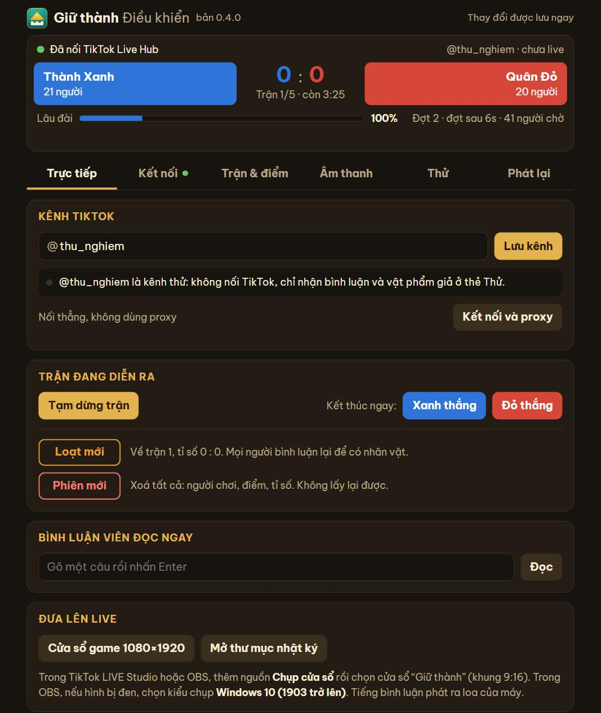

# Giữ thành

Game cho **TikTok LIVE**: một thành vuông có 4 cổng, lâu đài ở giữa. **Thành Xanh** (phe Thủ) giữ lâu đài, **Quân Đỏ**
(phe Đánh) từ 4 trại vây bốn mặt để phá. Ai bình luận cũng có một nhân vật trên sân, avatar của họ hiện trên đầu nhân vật.
Tim, chia sẻ, đố vui và vật phẩm của người xem quyết định trận đấu. Bình luận viên (giọng đọc tiếng Việt) tường thuật trận.

<p align="center">
  
  &nbsp;
  
</p>

> **In English:** an open-source game for TikTok LIVE streams (Windows, Vietnamese UI). Viewers' comments, likes, shares,
> quiz answers and gifts become soldiers of two teams fighting over a citadel. It connects to a live room straight from
> your computer or through your own proxies, your choice. The code is in the public domain (Unlicense): no copyright
> is claimed. The pixel art is by someone else and is not in this repository (see "Hình ảnh").

```
TikTok LIVE ─► hub (trong ứng dụng, ws://127.0.0.1:8765) ─► game (http://127.0.0.1:8767) ─► cửa sổ 9:16 ─► TikTok LIVE Studio / OBS
```

Một ứng dụng, hai cửa sổ: **cửa sổ game** (khung dọc 9:16, đưa lên live) và **cửa sổ Điều khiển** (kênh, kết nối, luật,
giọng đọc, thử không cần live). Phần kết nối TikTok (gọi là *hub*) nằm sẵn bên trong, không phải cài gì thêm.

## Dùng ngay

1. Cài bằng file `TikTokGiuThanh-Setup-<bản>.exe` (trang **Releases** của kho này, nếu tác giả đã đăng), hoặc tự đóng gói
   theo mục [Chạy từ mã nguồn](#chạy-từ-mã-nguồn). Cần Windows 10 hoặc 11.
2. Mở **Giữ thành**. Trong cửa sổ **Điều khiển**, thẻ **Trực tiếp**: gõ ID kênh TikTok (hoặc dán cả đường link của
   kênh) rồi bấm **Lưu kênh**. Dòng ngay bên dưới cho biết kênh đang live hay chưa và game đã nhận được gì.
3. Trong TikTok LIVE Studio hoặc OBS, thêm nguồn **Chụp cửa sổ** và chọn cửa sổ "Giữ thành". Trong OBS, nếu hình bị đen,
   chọn kiểu chụp **Windows 10 (1903 trở lên)**. Tiếng bình luận phát ra loa của máy.
4. Muốn xem trước khi lên live: thẻ **Thử**, bấm **Bắt đầu giả lập** (60 người xem giả). Xem xong bấm **Phiên mới**.

Lần đầu mở, giọng đọc VieNeu tải mô hình khoảng 580 MB về máy; trong lúc đó giọng Edge đọc thay.

## Kết nối TikTok: nối thẳng hoặc qua proxy

Chọn ở cửa sổ Điều khiển, thẻ **Kết nối**, mục **Proxy**:

| | Nối thẳng | Qua proxy |
|---|---|---|
| Đi qua đâu | Mạng của chính máy này: TikTok thấy IP của máy | Chỉ qua proxy của bạn, không bao giờ dùng mạng của máy |
| Cần gì | Không cần gì | Ít nhất 1 proxy (HTTP hoặc SOCKS5). Proxy xoay thì thêm key và link đổi IP |
| Hợp với | Một kênh, dùng cá nhân | Nhiều kênh, hoặc khi không muốn lộ IP của máy |

- Máy **chưa có proxy nào** thì mặc định **nối thẳng**: cài xong là dùng được. Thêm proxy đầu tiên thì ứng dụng tự chuyển
  sang đi qua proxy. Sau đó muốn đổi lúc nào cũng được, kể cả giữa buổi live.
- Ứng dụng **không bao giờ tự đổi** từ cách này sang cách kia: đang bật proxy mà proxy chết thì nó chờ proxy sống lại
  hoặc xin IP mới, không rơi về mạng của máy.
- Hai proxy (hai key khác nhau) cho một kênh: một bên đổi IP thì bên kia vẫn nhận, gần như không hụt tin.
- Nếu hay gặp báo "server ký quá giới hạn": thêm **sign key** miễn phí của eulerstream.com ở mục **Cài đặt** của thẻ Kết nối.
- Key và mật khẩu proxy được mã hoá bằng DPAPI của Windows, lưu ở `%APPDATA%\TikTokLiveHub\config.json`.

Phần kết nối dùng thư viện không chính thức [TikTokLive](https://github.com/isaackogan/TikTokLive). TikTok có thể thay đổi
phía họ bất cứ lúc nào; dự án này không liên quan tới TikTok hay ByteDance.

## Luật

| | |
|---|---|
| Vào trận | **Bình luận một lần là có một nhân vật cho cả loạt** (không cần bình luận lại, vắng mặt nhân vật vẫn ở lại). Gõ `thủ` (hoặc `giữ`, `xanh`, `giữ thành`) vào Thành Xanh; `đánh` (hoặc `đỏ`, `tấn công`) vào Quân Đỏ; câu khác (kể cả câu trả lời đố vui) thì game xếp vào phe ít người hơn |
| Đổi phe | Gõ `đổi`: sang phe kia **ở đợt quân kế tiếp**, mỗi trận một lần |
| Đợt quân | Cứ **20 giây** có một đợt quân ra trận (đồng hồ "RA TRẬN SAU … giây" ở trên, và vòng đếm ngược trên mỗi trại, trên lâu đài): quân mới và quân vừa ngã ra cùng lúc, kèm vài lính có sẵn để mặt nào cũng có đánh nhau. Quân đang chờ **đứng xếp hàng thấy được** ở trại (phe Đánh) hoặc trong sân (phe Thủ) |
| Nhân vật | 7 bậc, hai phe giống nhau, khác màu: **Dân** (vá cổng) → **Lính kiếm** → **Lính giáo** (trâu, chặn đường) → **Cung thủ** (bắn xa) → **Thầy thuốc** (hồi sức) → **Đội trưởng** (quân quanh mình mạnh hơn) → **Tướng** |
| Vật phẩm | **Mỗi món thêm một quân** cho người tặng, ra sân ngay: giá một món (số xu) 1 / 5 / 10 / 20 / 30 / 99 ra Lính kiếm / Lính giáo / Cung thủ / Thầy thuốc / Đội trưởng / Tướng. Món **không đúng sáu giá ấy** được chia thành nhiều quân cho vừa đủ giá, quân to trước: 50 = Đội trưởng + Thầy thuốc, 199 = 2 Tướng + 1 Lính kiếm, 7 = Lính giáo + 2 Lính kiếm. Một người có tối đa **30 quân**, cùng tên, cùng avatar, ra trận cùng một mặt thành; đã đủ 30 thì món mới **hồi đầy sức** cho quân đang yếu nhất của họ |
| Ngã | Quân **từ bình luận** ngã thì về làm Dân, chờ đợt quân sau là quay lại. Quân **từ vật phẩm** ngã là **mất** (các quân khác của người ấy không sao) |
| Dân phe Thủ | Tự chia về bốn cổng theo tình hình: cổng nào hỏng nặng, đang vỡ hoặc bị đánh đông thì được dồn nhiều Dân hơn; lúc yên thì chia đều, không cổng nào bị bỏ trống. Lính phe Thủ rảnh tay cũng sang cổng đang bị đánh |
| Hết mỗi trận | Quân bình luận nào **còn là Dân thì nghỉ**, chủ của nó **bình luận lại một câu** (câu gì cũng được, trả lời đố hay gửi vật phẩm cũng tính) mới ra trận tiếp. Quân đã có bậc (Lính kiếm trở lên) và quân từ vật phẩm thì tự ra. Ai vừa bình luận trong 30 giây cuối trận thì khỏi gõ lại |
| Trận nộ | Khi một phe đã thắng tới mức phe kia **không thể đuổi kịp** (3 trong 5), trận kế tiếp là **trận nộ**: mỗi phe có một **người khổng lồ** (yêu tinh cầm đuốc lửa, màu của phe), hai người đấu nhau trước cổng nam, đòn càng về cuối càng nặng. Người khổng lồ nào **gục trước thì phe đó thua**; hết giờ thì bên còn nhiều sức hơn thắng. **Tim, chia sẻ, theo dõi** của người có nhân vật **tiếp sức cho người khổng lồ phe mình** (đủ 10 tim = 2 sức, mỗi người tối đa một lần mỗi 5 giây từ tim; chia sẻ 1, theo dõi 5). **Không ai công thành** trong trận này: lính và dân hai phe **kéo hết về chỗ hai người khổng lồ**, đánh nhau và **đánh cả người khổng lồ đối phương**; vẫn ra quân 20 giây một đợt, vật phẩm vẫn thêm quân; mỗi quân ngã làm người khổng lồ phe mình yếu đi một chút. Ảnh người thả tim, chia sẻ, theo dõi **bay lên sau lưng người khổng lồ phe họ** (không bay ở cột bên trái như trận thường) |
| Sau trận nộ | **Phe đang dẫn thắng**: thắng luôn cả loạt, không đánh các trận còn lại. **Phe bị dẫn thắng**: tỉ số được **cân bằng** (ví dụ 3 : 3) và hai phe **đánh tiếp một trận thường**; đang ngang nhau nên ai thắng trận đó là thắng loạt. Mỗi loạt chỉ có một trận nộ |
| Không cần tặng | **Đố vui đúng** (thưởng khi hết giờ của câu hỏi): quân từ bình luận đang là Dân thì lên **Lính kiếm**; đúng nữa thì có **thêm một Dân**, rồi Dân đó cũng lên Lính kiếm (tối đa 2 quân không cần vật phẩm); cả hai đã là lính thì đố đúng **hồi 60% sức** cho quân đang yếu nhất. **Tim, chia sẻ, theo dõi** rẻ và dễ spam nên không lên bậc, chỉ **hồi một chút sức cho một quân** (quân yếu nhất của người đó; cứ **đủ 10 tim** của một người thì +5 sức, tim lẻ để dành cho lượt sau, một lượt tim chỉ cộng một lần; chia sẻ 2, mỗi phút một lần; theo dõi 10, một lần). Người chưa có nhân vật mà thả tim thì không được gì và không bị ghi lại |
| Một trận | 4 phút (đổi được). Cổng về 0 là **vỡ**: Quân Đỏ tràn vào đánh lâu đài; Dân vá lại tới 30% thì cổng đứng lại. **Lâu đài sập: Quân Đỏ thắng. Hết giờ lâu đài còn đứng: Thành Xanh thắng** |
| Hết trận, hết loạt | Hết mỗi trận hiện **bảng xếp hạng hai phe cạnh nhau**: phe thắng bên trái, to và sáng hơn, người dẫn đầu có thẻ riêng (vương miện, số điểm, số địch hạ, số quân); phe thua bên phải, mờ hơn. Điểm = việc làm trên sân (hạ địch ×10, phá cổng, hồi sức, vá cổng) + vật phẩm ×5 + đố đúng ×10. Loạt 5 trận (đổi được) có tỉ số và chung cuộc. **Bậc và số quân giữ nguyên qua các trận trong loạt; hết loạt thì xoá hết, ai chơi tiếp phải bình luận lại** |
| Đố vui | 521 câu trong `web/src/data/quiz400.js` (đố mẹo và câu đố dân gian lấy từ các trang câu đố trên mạng, không tự nghĩ), ba loại: **đố vui**, **đố hiểu biết**, **đố mẹo** (bảng câu hỏi ghi rõ "ĐỐ MẸO"). Trả lời bằng bình luận, tối đa 3 chữ, 30 giây một câu |

### Giữ cho hai phe luôn sát nút

- Đòn đánh vào cổng và lâu đài được chia theo số người của đội: live 6 người hay 240 người, trận dài như nhau.
- Đội ít người hơn thì mỗi người mạnh hơn; đội vừa thua được +3% mỗi trận thua liền (tối đa +9%); mỗi trận có ±10% may rủi.
- Lính gác cổng nào không có địch thì tự sang cổng đang bị đánh; Dân rảnh thì sang vá cổng hỏng nặng nhất; Tướng phe Thủ tìm tới cổng có tướng phe Đánh.
- Đo bằng `cd web && npm run tune` (hàng trăm trận không hình): hai phe ngang nhau, Quân Đỏ thắng khoảng 30–48%.
  Một Tướng hay Đội trưởng gần như quyết định trận trong live nhỏ, trừ khi phe kia cũng có.
- Điểm yếu đã biết: hai phe lệch người nhiều thì phe đông thắng phần lớn các trận.

### Chạy live nhiều giờ

- Chỉ người **bình luận hoặc tặng** mới được ghi lại, và chỉ trong một loạt: hết loạt game xoá hết người chơi (danh sách người theo dõi
  được giữ riêng), nên dữ liệu không bao giờ lớn hơn số người của một loạt (5 trận, khoảng 20 phút).
- Live rất đông: mỗi phe tối đa 150 quân của người xem trên sân cùng lúc, quân còn lại giữ chỗ trong hàng chờ; hình chỉ vẽ 170 nhân vật
  (ưu tiên người xem và bậc cao).
- `cd web && npm run soak` chơi nhanh một buổi live dài không hình (mặc định 6 giờ, 2 người bình luận mới mỗi giây) và in sau mỗi giờ:
  số người đang lưu, cỡ tệp phiên, bộ nhớ, thời gian một bước trận. Đo ngày 10/11/2026 (6 giờ, 39.924 người bình luận): số người đang lưu
  lên xuống theo loạt từ 0 tới khoảng 2.000, bộ nhớ 8–13 MB, một bước trận 0,2 ms, không có gì tăng theo giờ.
- Bảng tên (kèm thanh sức) đặt trên quân mạnh nhất của mỗi người và lớn dần theo bậc; các quân khác của họ chỉ có vòng avatar nhỏ.
- Ứng dụng chạy hai tiến trình: một "người gác" tự mở lại game khi game sập hoặc bị tắt (tối đa 3 lần / 10 phút). Phiên chơi
  lưu trên đĩa nên mở lại là đánh tiếp.

### Âm thanh

Mọi tiếng đều do game tự tạo (Web Audio, không có file âm thanh, không có nhạc nền để người live tự mở nhạc của mình):

- Tiếng nhỏ, êm tai, có khoảng nghỉ để đông người vẫn không ồn: kiếm chạm kiếm, búa gỗ vá cổng, tên bay, chuông hồi sức, tiếng ngã.
- Nhạc ngắn cho khoảnh khắc (2–4 giây): Đội trưởng / Tướng ra trận (kèn, trống, chuông), cổng mở, cổng vỡ, lâu đài còn nửa / một phần tư
  (chuông báo động), lâu đài sập, giữ được thành, hết loạt, 60 và 30 giây cuối (dây trầm), 10 giây cuối (nhịp tim), câu đố mới / đúng / đáp án.

### Camera và bình luận

- 6 góc máy (toàn cảnh, 4 cổng, lâu đài) và bám theo một nhân vật. Thứ tự ưu tiên: vật phẩm (lớn cắt nhỏ) → cổng vỡ → lâu đài còn nửa /
  một phần tư → tướng ngã → hạ liên tiếp 5 mạng → cổng dựng lại → người mới ra trận. 30 giây cuối chỉ vật phẩm lớn mới cắt cảnh.
- Bình luận viên: cảm ơn theo tên kèm bậc mới của người tặng → cổng vỡ, lâu đài, tướng ngã (ai hạ) → đếm ngược → hạ liên tiếp →
  đố vui → chào người mới → mẹo chơi và câu đùa khi vắng.
- Bình luận viên **không bao giờ nói "xu" hay "quà", không mời tặng, không mời thả tim / chia sẻ / theo dõi** (có kiểm thử chặn:
  `web/test/commentary.test.js`).

## Hình ảnh

Hình trong game lấy từ hai gói **Tiny Swords** của Pixel Frog (<https://pixelfrog-assets.itch.io/tiny-swords>).
**Kho mã này không chứa các hình đó**: giấy phép của gói hiện tại cho dùng trong dự án cá nhân và thương mại nhưng
không cho phát tán lại gói hình, kể cả đã chỉnh sửa. Ai chạy từ mã nguồn thì tự tải (miễn phí) rồi để công cụ chép sang:

1. Ở trang trên, tải **Tiny Swords (Free Pack)** và bản cũ **TS_old version (CC0 Licensed)**.
2. Giải nén sao cho có hai thư mục:
   - `assets_src/tiny-swords/Tiny Swords (Free Pack)/`
   - `assets_src/tiny-swords-old/Tiny Swords (Update 010)/`
3. Chạy (cần thư viện Pillow: `pip install pillow`):
   ```bash
   python tools/prep_assets.py
   ```
   Công cụ chép và ghép những tệp game dùng sang `web/public/ts/` (thư mục này cũng không đưa lên kho mã).

- **Gói hiện tại**: lính 5 loại 3 màu (xanh, đỏ, và vàng cho Đội trưởng, Tướng), lâu đài, tháp, nhà, cây, cừu, hiệu ứng
  nổ / bụi / lửa, chân dung từng loại lính, khung bảng, thanh sức, biểu tượng.
- **Bản cũ (CC0)**: lâu đài đổ nát, tháp gỗ, lều, nhà tranh, nấm, bí ngô, bù nhìn, yêu tinh cầm đuốc (người khổng lồ của trận nộ).

Nền đất, tường, cổng do game tự vẽ theo cùng bảng màu. Biểu tượng ứng dụng tự vẽ bằng `tools/make_icon.py`.

## Chạy từ mã nguồn

Cần: Windows 10 / 11, **Python 3.12**, **Node.js 20** trở lên, và hình ảnh như mục trên.

```bash
python -m venv .venv
```
```bash
.venv\Scripts\python -m pip install -r requirements.txt
```
```bash
cd web && npm ci && npm test && npm run build
```

Mở ứng dụng (hai cửa sổ, có hub bên trong):

```bash
.venv\Scripts\python -m giuthanh
```

Chỉ chạy máy chủ để làm việc trên trình duyệt (dữ liệu thử để riêng, hub thử ở cổng riêng nên không đụng bản đã cài):

```bash
set TIKTOKGIUTHANH_HOME=.devhome&& .venv\Scripts\python -m giuthanh --dev --port 8777 --hub-port 8795
```

Rồi mở `http://127.0.0.1:8777/` (game) và `http://127.0.0.1:8777/control` (điều khiển). Trong trang điều khiển, thẻ **Thử**:

- **Bắt đầu giả lập** (và **Giả lập + vào trận nộ**, **Dừng**): 60 người tên đủ kiểu tự vào hai phe rồi liên tục thả tim, chia sẻ, theo dõi,
  bình luận, gửi vật phẩm đủ mức giá, trả lời đố (`web/src/demo.js`). Không cần hub, tự dừng sau 12 phút; xem xong bấm **Phiên mới**.
- **+5 / +20 mỗi đội**, **Cho họ thả tim, trả lời đố**.
- Bảng 12 nút vật phẩm (6 giá × 2 phe) và ô **Giá lẻ**: một người thử của phe đó nhận món giá ấy.
- **Cho đợt quân ra ngay**, **Trận nộ** (Xanh dẫn / Đỏ dẫn).
- Gửi bình luận / vật phẩm / tim qua hub: đặt kênh là `thu_nghiem` (kênh tên `thu_…` không bao giờ nối TikTok).

Kiểm thử:

```bash
.venv\Scripts\python -m unittest discover -s tests -t .
```
```bash
cd web && npm test
```

Đóng gói:

- `build.bat`: chạy kiểm thử, build web, đóng gói `dist\TikTokGiuThanh\TikTokGiuThanh.exe` (PyInstaller, kèm hub), rồi tự chạy `--selftest`.
- `build_setup.bat`: đóng gói lại rồi tạo file cài đặt `release\TikTokGiuThanh-Setup-<bản>.exe` (cần [Inno Setup 6](https://jrsoftware.org/isinfo.php)).
  `build_setup.bat nobuild`: chỉ tạo file cài đặt từ `dist` vừa đóng.
- Nâng `VERSION` trong `giuthanh/config.py` (và `tools/version_info.txt`) mỗi lần đưa bản mới.

## Mã nguồn

- `web/src/game/rules.js`: phe, bậc, điểm, trận, loạt (không có giao diện). `battle.js`: mô phỏng trận đánh (các con số cân bằng ở `TUNE`).
- `web/src/game/commentary.js`: bình luận viên; `speech.js`: hàng đợi giọng đọc; `director.js`: camera; `quiz.js`: đố vui;
  `channel.js`: tên kênh (viết theo cách hub gọi).
- `web/src/scene/field.js`: vẽ sân (canvas 2D), hiệu ứng, camera; `assets.js`: bảng hình của gói Tiny Swords.
- `web/src/ui.js`, `style.css`: các bảng trên màn hình; `control.*`, `conn.js`: cửa sổ Điều khiển và trạng thái kết nối.
- `giuthanh/`: ứng dụng Windows (pywebview): hai cửa sổ, máy chủ nội bộ chỉ nghe ở `127.0.0.1` và chỉ nhận lệnh từ chính các trang
  của ứng dụng, giọng đọc, người gác tự mở lại, dòng `[SỨC KHỎE]` mỗi 5 phút trong `app.log`.
- `hub_src/hub/`: hub, phần kết nối TikTok LIVE (proxy xoay hoặc nối thẳng, nối lại, đếm combo, lọc trùng, gửi bù). Nó là một dự án
  riêng; đây là bản chép, và là bản được chạy. Tác giả sửa hub ở dự án gốc rồi chạy `python tools/sync_hub.py`.
- `tests/`, `web/test/`: kiểm thử. `web/tools/`, `tools/`: công cụ đo cân bằng, đo chạy lâu, chuẩn bị hình.

## Dữ liệu và riêng tư

- Cài đặt và phiên chơi: `%APPDATA%\TikTokGiuThanh` (`settings.json`, `state.json`, `backups\`, `app.log`). Cài đặt của hub
  (proxy, key): `%APPDATA%\TikTokLiveHub`. Gỡ ứng dụng thì được hỏi có xoá dữ liệu không.
- Ứng dụng không gửi dữ liệu về cho tác giả hay bên nào khác. Nó chỉ nối tới: TikTok (phòng live, ảnh đại diện người xem),
  máy chủ ký của eulerstream.com (thư viện TikTokLive cần để vào phòng live), dịch vụ giọng đọc Edge của Microsoft
  (nhận câu chữ cần đọc, khi dùng giọng Edge hoặc khi giọng trên máy chưa sẵn sàng), Hugging Face (tải mô hình giọng
  VieNeu một lần), nhà cung cấp proxy của bạn (nếu dùng proxy xoay), và ipinfo.io qua proxy (để hiện IP mà TikTok thấy;
  khi nối thẳng thì không hỏi).

## Giấy phép

- **Mã nguồn**: **không giữ bản quyền**. Tác giả đưa toàn bộ mã trong kho này vào phạm vi công cộng ([The Unlicense](LICENSE)):
  ai cũng được dùng, sửa, chia sẻ, bán, không cần xin phép và không cần ghi nguồn. Không kèm bảo hành nào.
- **Hình ảnh** Tiny Swords © Pixel Frog: không nằm trong kho mã này, dùng theo giấy phép của tác giả gói hình (xem mục Hình ảnh).
- **Thư viện** (không nằm trong kho mã, được cài theo `requirements.txt` và `web/package.json`), mỗi thư viện theo giấy phép riêng:
  pywebview, httpx, websockets (BSD), edge-tts (LGPL 3), VieNeu-TTS (Apache 2.0), phông Be Vietnam Pro (OFL).
- **TikTokLive** dùng giấy phép **AGPL 3 có điều khoản bổ sung** (mục 18–21 trong file LICENSE của thư viện): cho phép tích hợp vào
  game TikTok LIVE, kể cả thương mại, mà không phải theo AGPL; điều khoản đó **không áp dụng** nếu dùng làm dịch vụ chuyển tiếp
  WebSocket, API lấy dữ liệu hay dịch vụ lưu trữ cho bên thứ ba qua mạng. Hub ở đây chỉ chạy trên máy của người dùng (`127.0.0.1`).
  Nếu bạn đổi dự án này thành một dịch vụ như vậy, hãy đọc kỹ giấy phép đó trước.
- Dự án này không thuộc và không được TikTok hay ByteDance bảo trợ. "TikTok" là nhãn hiệu của chủ sở hữu tương ứng.
